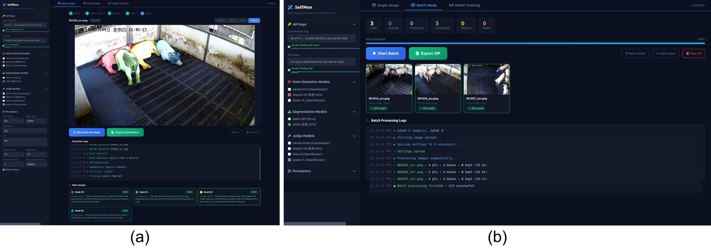

# SelfMon-Labeling

The official implementation and source code for **Automatic image labeling framework based on multiple vision-language models and self-monitoring mechanism for animal monitoring**.


## Features

* **Self-Supervised Mechanism**
* **One-click annotation and training platform**
* **High Flexibility**: The platform support fully local inference (local models) or fully online inference (by API).


## Installation

Ensure you have Python 3.8+ and PyTorch installed. Clone the repository and install the required dependencies using the following commands:

```bash
# Clone the repository
git clone XXX.git
cd SelfMon-Labeling

# Install dependencies
pip install -r requirements.txt
```

## Usage

Execute the main script to start the SelfMon-Labeling process:

```bash
python app.py
```


## Citation

If you use this code or our work in your research, please cite it as follows (will be given after paper acceptance):

```bibtex
@article{selfmon2026,
  title={Automatic image labeling framework based on multiple vision-language models and self-monitoring mechanism for animal monitoring},
  author={Your Name and Collaborators},
  journal={},
  year={2026}
}
